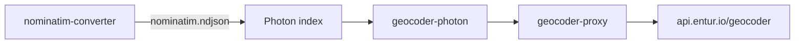

# Geocoder

Entur's geocoder: autocomplete and reverse geocoding for Norwegian stop places, addresses,
place names and points of interest. Two components - a patched
[Photon](https://github.com/entur/photon) search backend on OpenSearch, and a Ktor proxy in
front of it serving a v3 API plus a Pelias-compatible v2. The search index is built from a
Nominatim NDJSON dump produced by
[nominatim-converter](https://github.com/entur/nominatim-converter).



Public API: [developer.entur.no/apis/geocoder](https://developer.entur.no/apis/geocoder) -
`/v3/autocomplete`, `/v3/reverse`, `/v3/place`.

```bash
curl "https://api.entur.io/geocoder/v3/autocomplete?q=Oslo+S"
```

## Running locally

### Simple

One command converts every source with `converter-prod.json`, builds the index and starts
Photon. It downloads the whole country, so expect it to take a while.

```bash
cd photon
./import/download-photon-jar.sh
./full-local-reimport-and-start.sh

# In another terminal, from the repo root - or run no.entur.geocoder.proxy.AppKt from your IDE
./gradlew :proxy:run
```

Started from a console the proxy talks to `http://localhost:2322`; set `PHOTON_URL` to point it
somewhere else.

### Complex

The same steps one at a time, for a different config, or to skip the conversion and use what CI
built:

```bash
cd photon
./import/download-photon-jar.sh

# EITHER convert the data - import/config/converter-{prod,dev,local,nordic,sweden-test,denmark-test}.json
./import/create-nominatim-data.sh import/config/converter-local.json -z

# OR take the ndjson CI last built
./download-latest-nominatim-data.sh

./import/create-photon-data.sh nominatim.ndjson.gz

# OR skip both and take CI's finished index
rm -rf photon_data && ./download-latest-photon-data.sh

./photon-start.sh
```

Both download scripts take `[suffix] [tag]` and default to the newest build in the bucket.
Pass `prod` for the index prd serves (read from the cluster, so it needs prd access) or a full
tag. An index was imported with the `photon.jar` of its own build, which can differ from the one
`download-photon-jar.sh` pins; if Photon refuses to open it, that is why - take a data tag from
the same build as your jar.

### Trying it out

```bash
curl -s 'http://localhost:8080/v3/autocomplete?q=sk%C3%B8yen%20stasjon&limit=20'
curl -s 'http://localhost:8080/v3/reverse?lat=59.92&lon=10.67&radius=1&limit=10&layers=address,locality'

# v2 (Pelias-compatible) uses different parameter names
curl -s 'http://localhost:8080/v2/autocomplete?text=sk%C3%B8yen%20stasjon&size=20'
```

`&debug=true` also reveals the native Photon results with `importance` (input weight) and
`score` (weight calculated by Photon).

## Inspecting the index

Photon directly - category values are case-sensitive, so `layer.stopPlace` matches while
`layer.stopplace` silently returns nothing:

```bash
curl -s 'http://localhost:2322/api?q=Berglyveien&include=layer.stopPlace'
```

OpenSearch directly. Document ids are the entity id with `:` replaced by `-`
(`NSR-StopPlace-58404`, `KVE-PostalAddress-12191345`), not numeric OSM ids - `osm_id` is 0 for
NSR documents, so use `extra.id` from the API response as the key.

```bash
curl -s 'http://localhost:9201/photon/_mapping' | jq .   # available fields
curl -s 'http://localhost:9201/photon/_doc/NSR-StopPlace-58404' | jq .
```

Handy for checking what the converter actually wrote, e.g. the alt names a multimodal parent
inherited from its children:

```bash
$ curl -s 'http://localhost:9201/photon/_doc/NSR-StopPlace-58404' | jq -c '._source.name'
{"default":"Nationaltheatret","alt":"Nationaltheatret stasjon;Nasjonalteatret;Nationaltheatret"}
```

### Score vs. importance

`importance` is set by the converter in the Nominatim data; `score` is what Photon computes
from it at query time.

```bash
$ curl -s 'http://localhost:8080/v2/autocomplete?text=Oslo&debug=true&size=1' \
  | jq -c '.geocoding.debug.raw_data[] | [.localeTags.name.default, .infos.importance, .score]'
["Oslo",0.92,2.8717440524466067]
["Oslo S",0.538821,2.323909030548797]
["Oslo",0.27596,2.27596]
["Oslo lufthavn",0.550358,2.006965529061908]
```

<sub><sup>(Debug shows three more results than asked for, see `PhotonAutocompleteRequest.RESULT_PRUNING_HEADROOM`. Both numbers change with every index build, so treat them as illustrative. The two "Oslo" rows are the group of stop places and the locality.)</sup></sub>

## Deployment

Images are built, pushed and deployed from the private
[entur/geocoder-deployment-config](https://github.com/entur/geocoder-deployment-config), which
also runs the nightly import. A push to `main` touching the proxy triggers a proxy deploy there
(dev, then tst and prd after approval); Photon builds are started by hand. This repo runs lint,
tests and, on pull requests, Docker builds and scans.

## Data artifacts (GCS)

Built artifacts live in the public bucket `ent-geocoder-prd`:

| Prefix                   | Contents                                      |
| ------------------------ | --------------------------------------------- |
| `nominatim-data/`        | `nominatim.ndjson.gz` per build (+ `.sha256`) |
| `nominatim-data-se/`     | Sweden variant                                |
| `nominatim-data-dk/`     | Denmark variant                               |
| `nominatim-data-nordic/` | Norway + Sweden variant                       |
| `photon-data/`           | `photon_data.tar.gz` per build (+ `.sha256`)  |
| `photon-data-se/`        | Sweden variant                                |
| `photon-data-dk/`        | Denmark variant                               |
| `photon-data-nordic/`    | Norway + Sweden variant                       |
| `data-sources/`          | Daily-refreshed source files                  |

Each build writes to `<prefix>/<tag>/<filename>`. A full build gives one tag to both the docker
image and the upload, so `geocoder-photon:<tag>` pairs with `photon-data/<tag>/photon_data.tar.gz`.
The nightly uploads new data under a new tag while prd keeps the image it runs. Either way the
tag's `-SHA` suffix names the commit the data was imported from. The newest build is the last
`main.*` prefix; objects expire after 90 days.

## Query synonyms

[photon/synonyms.json](photon/synonyms.json) goes to `serve` via `-synonym-file`;
`synonyms-se.json` / `synonyms-dk.json` are picked by the `SYNONYM_FILE` build arg (Nordic uses
`synonyms.json`). Applied at query time and baked into the image, so editing one needs no reimport
but does need a Photon build promoted to prd - the nightly reuses prd's image and will not pick it up.

- Single tokens, no spaces. CI rejects the rest.
- `gt` and `gt.` are separate terms, both needed.
- Only add a rule that measurably changes a result. Prefixes (`pl`) and one-character variants
  (`ferje`/`ferge`) already match; `vgs` and `stasjon,station` were measured and rejected.
- Compounds are one token, so `kirkevn` is out of reach. That needs
  [photon#97](https://github.com/komoot/photon/issues/97).

## Releasing a patched Photon

Ranking happens inside Photon, so most search tuning lands in the fork rather than here.

1. Make the change in a checkout of [komoot/photon](https://github.com/komoot/photon) and build it with `./gradlew build`.
2. Create a tag and push it to [entur/photon](https://github.com/entur/photon) with `git push --tags entur`.
3. Draft a release at [entur/photon/releases/new](https://github.com/entur/photon/releases/new), select the tag, attach `photon-<tag>.jar` from Photon's `target/`, check "Set as a pre-release" and publish.
4. Copy the asset link and update `PHOTON_JAR` and `PHOTON_JAR_SHA256` in [photon/import/download-photon-jar.sh](photon/import/download-photon-jar.sh).
5. Push, then run `photon.yml` in entur/geocoder-deployment-config with target `dev only`.
6. Once dev looks right, promote it to prd. The nightly imports from the commit prd runs, so an unpromoted jar never reaches production.

## Links

**Metrics** - other teams' recording rules select on Spring Boot's labels for `http.server.requests` (`uri`, `status`, `method`, `outcome`, `exception`). Photon's Javalin plugin emits those names already, but Ktor calls the route label `route`, so the proxy remaps it in [RequestMetrics.kt](proxy/src/main/kotlin/no/entur/geocoder/proxy/metrics/RequestMetrics.kt).

**Dashboards** - [Photon metrics](https://grafana.entur.org/d/VpZ62_2Wk/jvm-overview-prometheus?orgId=1&var-datasource=000000002&var-label=app&var-name=geocoder-photon&var-prometheus_group=kub-ent-dev-001&from=now-6h&to=now) ·
[Proxy metrics](https://grafana.entur.org/d/VpZ62_2Wk/jvm-overview-prometheus?orgId=1&var-datasource=000000002&var-label=app&var-name=geocoder-proxy&var-prometheus_group=kub-ent-dev-001&from=now-6h&to=now)

**Ours**

- [nominatim-converter](https://github.com/entur/nominatim-converter) - builds the index this proxy queries. Importance lives in `src/common/importance.rs`, categories in `src/common/category.rs`
- [entur/photon](https://github.com/entur/photon) - the patched fork that does the actual ranking. [PhotonDocSerializer](https://github.com/entur/photon/blob/master/src/main/java/de/komoot/photon/opensearch/PhotonDocSerializer.java) decides which name fields get indexed and at what priority
- [geocoder-acceptance-tests](https://github.com/entur/geocoder-acceptance-tests)
- [bau](https://github.com/entur/bau) - v2 vs v3 comparison tool ([hosted](https://ent-bau-dev.web.app/))

**External**

- [photon](https://photon.komoot.io/) and the [photon pelias adapter](https://github.com/stadtulm/photon-pelias-adapter)
- [OSM dumps for photon](https://download1.graphhopper.com/public/experimental/extracts/by-country-code/no/) from graphhopper
- [Nominatim](https://github.com/osm-search/Nominatim) and its [database layout](https://nominatim.org/release-docs/latest/develop/Database-Layout/)
